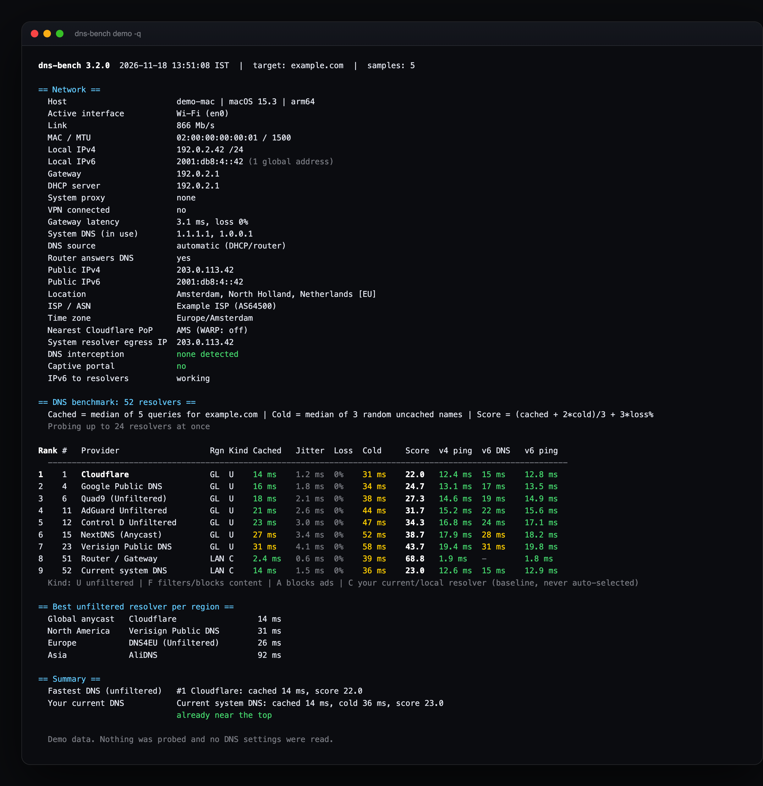
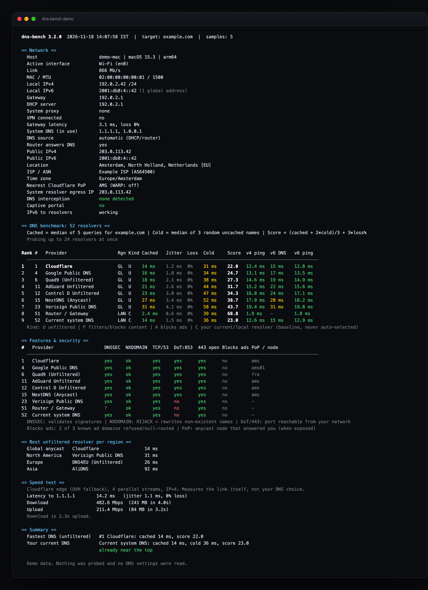
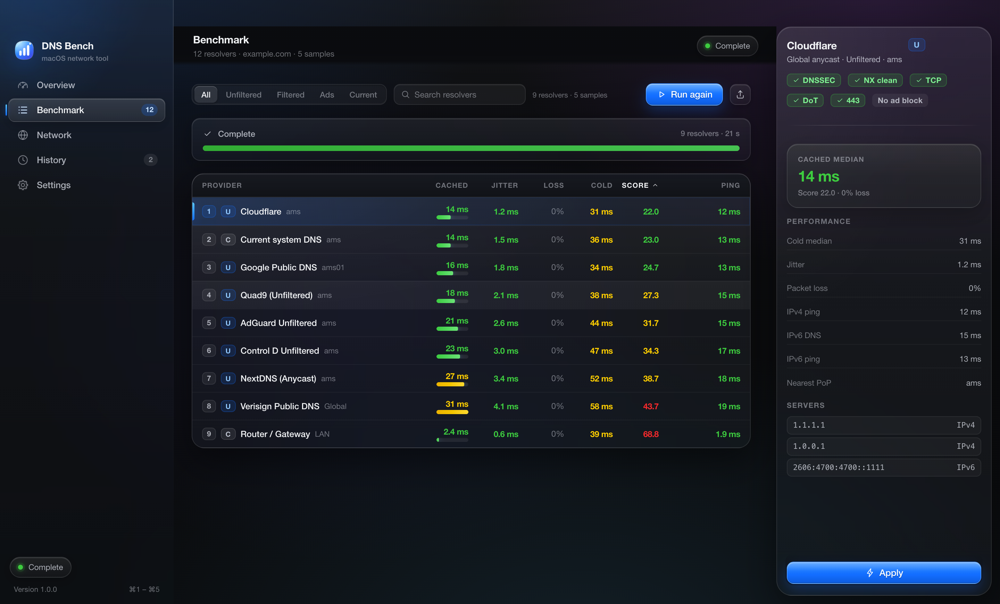

# dns-bench

**Your "best" DNS is someone else's.** Measure the resolvers from the machine you are actually on,
then switch only if the numbers say so.

One script: zsh on macOS and Linux, PowerShell on Windows. No daemon, no telemetry, no dependencies
past the tools the OS already ships. MIT, v3.3.0. A Mac app exists too — [it is at the
bottom](#the-mac-app).



*cached vs cold latency, jitter, loss, score — every resolver, ranked.*

## install

**macOS / Linux** — one line, no clone:

```sh
curl -fsSL https://raw.githubusercontent.com/dharmsharmaa/dns-bench/main/dns-bench.zsh -o dns-bench.zsh
chmod +x dns-bench.zsh
./dns-bench.zsh
```

`chmod +x` is not optional: without it you get `permission denied`. Do it once per download.

**Windows** (PowerShell):

```powershell
curl.exe -fsSL https://raw.githubusercontent.com/dharmsharmaa/dns-bench/main/dns-bench.ps1 -o dns-bench.ps1
powershell -ExecutionPolicy Bypass -File .\dns-bench.ps1
```

Windows blocks downloaded scripts. Either use `-ExecutionPolicy Bypass` as above, or unblock once:

```powershell
Unblock-File .\dns-bench.ps1
.\dns-bench.ps1
```

Benchmarking runs as a normal user; changing DNS needs an **elevated** PowerShell. Windows
PowerShell 5.1 and PowerShell 7+ both work.

No zsh? The script bootstraps itself. `sh dns-bench.zsh` or `bash dns-bench.zsh` re-execs under zsh.
If zsh is missing it detects `brew`, `apt`, `dnf`, `yum`, `pacman`, `zypper` or `apk`, shows the
command it would run, and asks first. Unattended: `DNSBENCH_ASSUME_YES=1 sh dns-bench.zsh`.

Required tools: `dig`, `curl`, `perl`, `awk`, `ping` — all present on macOS. On Linux install
`dnsutils` (Debian/Ubuntu) or `bind-utils` (Fedora/RHEL), plus `iproute2`. `openssl`, `traceroute`,
`lsof` and `netstat` are optional; the commands that use them degrade rather than fail.

## install as a system command

Run it as `dns-bench` from anywhere instead of `./dns-bench.zsh`:

```sh
./dns-bench.zsh install           # ~/.local/bin/dns-bench, no sudo
./dns-bench.zsh install --system  # /usr/local/bin/dns-bench, sudo
dns-bench
```

`install` copies the script to `~/.local/bin` and tells you if that directory is not on your `PATH`.
`--system` (or running as root, or an already-writable `/usr/local/bin`) installs to
`/usr/local/bin`. Either way the copy is `chmod 755`, so an update never leaves you with `permission
denied`.

If the directory is not on `PATH`, add it to your shell rc:

```sh
export PATH="$HOME/.local/bin:$PATH"
```

Windows has no `install` command. Keep the file somewhere permanent and wrap it in your profile:

```powershell
New-Item -ItemType Directory -Force "$HOME\bin" | Out-Null
Move-Item .\dns-bench.ps1 "$HOME\bin\dns-bench.ps1"
Add-Content $PROFILE 'function dns-bench { & "$HOME\bin\dns-bench.ps1" @args }'
```

Open a new PowerShell window and `dns-bench` works the same way.

Remove the command and any schedule with:

```sh
dns-bench uninstall
```

## quick start

```sh
dns-bench -q -N              # report only, changes nothing, about 40 seconds
dns-bench best -y            # quick benchmark, apply the winner
dns-bench test example.com   # why does this one domain fail
dns-bench speed              # is the link slow, or is it DNS?
dns-bench doctor             # what is missing on this machine
```

## command reference

Read-only commands never touch DNS or system settings. Mutating commands change something — DNS
servers, the cache, an installed file, a schedule — and say so before they do. `-N` forces
report-only mode on the commands that would otherwise apply DNS.

`dns-bench help <command>` prints usage and examples for a single command, e.g. `dns-bench help
ports`.

### run

Full benchmark and diagnostics, then a menu asking what to apply. **Mutating** — it asks before
changing DNS; `-N` makes it read-only.

```
dns-bench [run] [options]
```

| flag | default | meaning |
|---|---|---|
| `-d DOMAIN` | `google.com` | name used for cached-latency samples |
| `-n N` | `5` | samples per resolver, 1-20 |
| `-t K` | `5` | resolvers in the popular-services test, 1-12 |
| `-s` | off | skip the popular-services test |
| `-c` | off | skip the continent latency test |
| `-q` | off | quick mode: `-s -c`, 3 samples, 4 s speed phases |
| `-N` | off | report only, never change DNS |
| `-y` | off | apply the best resolver without asking |
| `-o FILE` | auto | write the CSV here instead of next to the script |
| `--no-csv` | off | do not auto-save a CSV |
| `--no-progress` | off | plain log output, no progress bar |
| `-P` | off | privacy: skip external IP/geo lookups |

```sh
dns-bench
dns-bench -q -N -o baseline.csv
```

Cold lookups weigh double in the score, so a resolver with a great warm cache and a bad first answer
does not win (more in [picking a resolver](#picking-a-resolver)):

```
(cached + 2*cold) / 3 + 3*loss%
```

### best

Quick benchmark that skips the service, continent and slow feature tests, then applies the fastest
unfiltered resolver. **Mutating** unless `-N`.

```
dns-bench best [-N] [-y] [-n N] [-d DOMAIN] [-o FILE]
```

```sh
dns-bench best
dns-bench best -y -N   # benchmark and print the winner, change nothing
```

### auto

Unattended benchmark for cron/launchd: compares the best resolver against what you use now and
switches only if the new score is clearly better. **Mutating**, but conservative. It runs quiet and
skips external lookups; from the schedule, its output is appended to `/var/log/dns-bench.log`.

```
dns-bench auto [--profile best|adblock] [--min-gain PCT]
```

| flag | default | meaning |
|---|---|---|
| `--profile P` | `best` | `best` = fastest unfiltered, `adblock` = fastest verified ad-blocker |
| `--min-gain PCT` | `20` | only switch if the new score is this much better |

```sh
dns-bench auto
dns-bench auto --profile adblock --min-gain 30
```

### set

Apply a resolver without benchmarking. Accepts a name substring or a row number from `dns-bench
list`. **Mutating**.

```
dns-bench set NAME|#
```

```sh
dns-bench set cloudflare
dns-bench set 7
```

Before changing anything it logs the previous setting to `~/.dns-bench-previous.txt`.

### reset

Return DNS to automatic (DHCP / router) and flush the cache. **Mutating**.

```
dns-bench reset
```

```sh
dns-bench reset
```

### adblock

Benchmark ad-blocking resolvers, verify that they actually block, and apply the fastest one. `off`
returns to automatic DNS. **Mutating**.

```
dns-bench adblock [off] [-N] [-y]
```

| flag | meaning |
|---|---|
| `-N` | report the winner, apply nothing |
| `-y` | apply without asking |

```sh
dns-bench adblock
dns-bench adblock off
```

"Blocks ads" is measured, not taken from a marketing page: three well-known ad domains must be
refused, NXDOMAIN'd or null-routed before a resolver is eligible. DNS blocking cannot remove ads
served from the same domain as the content, and it will not touch YouTube or most in-app ads.

### status

Show what DNS you use, where it came from, the installed copy, the schedule and the last log lines.
**Read-only**.

```
dns-bench status
```

```sh
dns-bench status
```

### list

Print the resolver table: number, name, kind, region, IPv4 and IPv6 endpoints. **Read-only**.

```
dns-bench list
```

```sh
dns-bench list
```

Kind is `U` unfiltered, `F` filters content, `A` blocks ads, `C` your current or local resolver
(baseline only, never auto-selected).

### flush

Flush the OS DNS cache. **Mutating** — cache only, no settings. Needs `sudo`.

```
dns-bench flush
```

```sh
dns-bench flush
```

### test

Troubleshoot one domain and end with a plain-English verdict. **Read-only**.

```
dns-bench test DOMAIN [-r LIST] [-T TYPES]
```

| flag | default | meaning |
|---|---|---|
| `-r LIST` | — | extra resolver IPs to compare, comma separated |
| `-T LIST` | `A AAAA CNAME NS MX TXT SOA CAA` | record types to print |

```sh
dns-bench test example.com
dns-bench test shop.example.com -T "A AAAA CNAME TXT" -r 10.0.0.53
```

It checks A records through several resolvers, prints record types, queries the authoritative name
servers (AA flag, SOA serial sync), validates DNSSEC, tests TCP 443/80 and HTTPS with certificate
verification, tries HTTPS over IPv6, shows reverse DNS of the answer, and groups the verdict by
cause.

### info

Network inventory only: interfaces, addresses, gateway, DNS in use, external identity and health
checks. **Read-only**. Add `-P` to skip external lookups.

```
dns-bench info [-P]
```

```sh
dns-bench info
dns-bench info -P     # no external IP or geo lookups
```

### speed

Measure the link itself. DNS choice does not affect it. **Read-only**; only writes a CSV if you ask
for one.

```
dns-bench speed [--duration SECS] [--no-upload] [-q] [-o FILE]
```

| flag | default | meaning |
|---|---|---|
| `--duration SECS` | `10` | seconds per phase, 2-60; `-q` uses 4 |
| `--no-upload` | off | skip the upload phase |
| `-o FILE` | — | save latency/download/upload as CSV |
| `-q` | off | 4 s phases |

```sh
dns-bench speed
dns-bench speed --duration 5 --no-upload -o speed.csv
```

### ports

TCP connect scan of a host from your machine. **Read-only**.

```
dns-bench ports HOST [PORTS]
```

| flag | default | meaning |
|---|---|---|
| `PORTS` | `22 53 80 443 853 3306 5432 6379 8080` | comma or space separated |
| `-q` | off | terse output |

```sh
dns-bench ports 1.1.1.1
dns-bench ports example.com 80,443,8080
```

Prints port, state (open, closed, filtered) and connect time in milliseconds. Bounded timeouts, so a
filtered port does not hang the run.

### http

One request, broken down by phase. **Read-only**.

```
dns-bench http URL [-q]
```

```sh
dns-bench http https://example.com
dns-bench -q http https://github.com
```

Prints the HTTP status code, then DNS, connect, TLS, TTFB and total time in milliseconds, plus
response size, redirect count and the final URL. This is the quickest way to see whether slowness is
resolution, connection, TLS or the server.

### tls

Inspect a certificate without a browser. **Read-only**.

```
dns-bench tls HOST[:PORT] [-q]
```

```sh
dns-bench tls example.com
dns-bench tls example.com:8443
```

Prints subject CN, issuer, notBefore, notAfter, days left, SAN count and protocol, and warns when
fewer than 21 days remain.

### trace

Path to a host. **Read-only**.

```
dns-bench trace HOST [-q]
```

```sh
dns-bench trace 1.1.1.1
dns-bench trace example.com
```

Uses `traceroute -n -q 1 -w 1 -m 16`, falling back to `tracepath`. Prints hop number, address and
RTT.

### asn

ASN and prefix lookup over DNS, not whois. **Read-only**.

```
dns-bench asn HOST|IP [-q]
```

```sh
dns-bench asn 8.8.8.8
dns-bench asn github.com
```

Prints ASN, prefix, country, registry and organisation via Team Cymru's DNS TXT service. Works where
outbound whois is blocked.

### ptr

Reverse DNS, with a check that matters. **Read-only**.

```
dns-bench ptr IP [-q]
```

```sh
dns-bench ptr 1.1.1.1
```

Prints the PTR record(s) and whether forward-confirmed reverse DNS passes — that is, whether the
name the PTR points at resolves back to the same address.

### leak

Compare the egress path of your system resolver against your public IP and against each configured
resolver. **Read-only**.

```
dns-bench leak [-q]
```

```sh
dns-bench leak
```

A resolver whose egress differs from your public IP is normal for a public resolver and suspicious
for a local one. A configured resolver that cannot be reached is flagged. This is how you spot a
router or VPN quietly rewriting port 53.

### propagation

Ask several public resolvers for the same record and group identical answers. **Read-only**.

```
dns-bench propagation DOMAIN [TYPE] [-q]
```

```sh
dns-bench propagation example.com
dns-bench propagation example.com TXT
```

Queries eight public resolvers, groups identical answer sets and prints an agreement summary. This
answers "has my change propagated", not "which resolver is fastest".

### mtu

Discover the path MTU with DF-set ping bisection, starting at a 1500-byte MTU (1472-byte payload).
**Read-only**.

```
dns-bench mtu HOST [-q]
```

```sh
dns-bench mtu 1.1.1.1
```

Useful when large responses or TLS handshakes stall but small requests work — usually a tunnel or
PPPoE link with a lower MTU.

### ecs

Check whether EDNS Client Subnet changes the answer you get. **Read-only**.

```
dns-bench ecs [HOST] [-q]
```

```sh
dns-bench ecs
dns-bench ecs www.netflix.com
```

Compares `+subnet=0` with `+subnet=<your-public-ip>/24` against an ECS-capable resolver (default
`8.8.8.8`, target defaults to `example.com`) and reports whether ECS changes the answer. If it does,
the resolver is choosing an answer based on your subnet, which is normal for CDNs and worth knowing
for privacy.

### ifaces

Interface inventory with no DNS queries. **Read-only**, and works offline.

```
dns-bench ifaces [-q]
```

```sh
dns-bench ifaces
```

Prints interface name, state, MTU, MAC, IPv4, IPv6 and media type.

### listen

Listening TCP sockets on this machine. **Read-only**.

```
dns-bench listen [-q]
```

```sh
dns-bench listen
```

Prints protocol, local address and port, and the owning process. Prefers `lsof`, falls back to
`netstat`. Handy for finding a local resolver or a proxy you forgot about.

### wifi

Current Wi-Fi link details. **Read-only**.

```
dns-bench wifi [-q]
```

```sh
dns-bench wifi
```

Prints SSID, BSSID (when the OS exposes it), channel, band, RSSI, noise, tx rate and security. Uses
`airport`/`wdutil` on macOS and `iw dev` on Linux. On Ethernet it says so.

### install

Copy this script into `PATH` as `dns-bench`. **Mutating**.

```
dns-bench install [--system]
```

| flag | default | meaning |
|---|---|---|
| `--system` | off | install to `/usr/local/bin` with sudo instead of `~/.local/bin` |

```sh
dns-bench install
dns-bench install --system
```

Already installed at the same path? It says so and changes nothing.

### uninstall

Remove the installed command and any schedule. **Mutating**.

```
dns-bench uninstall
```

```sh
dns-bench uninstall
```

### cron

Schedule `auto`. **Mutating** — writes a launchd daemon, a cron file or a systemd timer.

```
dns-bench cron WHEN [--at HH:MM] [--profile best|adblock]
dns-bench cron off
```

| argument / flag | default | meaning |
|---|---|---|
| `WHEN` | required | `hourly`, `6h`, `daily`, `weekly`, `Nd` (1-30), or a 5-field cron expression on Linux |
| `--at HH:MM` | `04:00` | time of day for `daily`, `weekly` and `Nd` |
| `--profile P` | `best` | `best` or `adblock` |

```sh
dns-bench cron daily --at 04:00
dns-bench cron 7d --profile adblock
dns-bench cron off
```

macOS uses a launchd daemon (`com.dns-bench.auto`) running as root and logging to
`/var/log/dns-bench.log`. `Nd` becomes a fixed interval there, so the time of day comes from when
you scheduled it, not `--at`. Linux uses `/etc/cron.d/dns-bench`, the root crontab, or a systemd
timer as a fallback. Raw five-field expressions are accepted on Linux.

The scheduled entry is `<path> auto --profile best|adblock`; the anti-flap `--min-gain` value is not
stored in the schedule, so edit the entry or run `auto` yourself if you need a different threshold.

### update

Pull the latest script from GitHub. **Mutating**.

```
dns-bench update [--check] [--force]
```

| flag | meaning |
|---|---|
| `--check` | print installed vs remote version, change nothing |
| `--force` | reinstall even when the versions match |

```sh
dns-bench update --check
dns-bench update
```

Before replacing anything it checks the download is large enough to be a script, starts with a
shebang, mentions `dns-bench`, and passes `zsh -n`. The old file is kept as
`dns-bench.zsh.<version>.bak`, and the installed copy is updated too.

### demo

Print a complete sample run from hardcoded data. **Read-only**, and it makes no network requests.

```
dns-bench demo
```

```sh
dns-bench demo
```

Fake, and obviously so: TEST-NET addresses, `example.com`, `Example ISP (AS64500)`, hostname
`demo-mac`. Layout, rankings and prompts are the real code path.

### doctor

Dependency and environment checklist. **Read-only**; exits 1 if a required dependency is missing.

```
dns-bench doctor [-q]
```

```sh
dns-bench doctor
```

Checks `dig`, `curl`, `perl`, `openssl`, `ping`, `traceroute`, `lsof`/`netstat` and
`networksetup`/`nmcli`, then prints privilege status, the installed copy, the schedule, the log tail
and the version. Works with no network at all.

### version

Print the version. **Read-only**.

```
dns-bench version
dns-bench --version
```

```sh
dns-bench version
```

### help

Print the grouped command list, or detail for one command. **Read-only**.

```
dns-bench help [command]
```

```sh
dns-bench help
dns-bench help ports
```

`-h` and `--help` are equivalent to `dns-bench help`.

## global flags

These apply to the commands that use them. zsh on the left, PowerShell on the right.

| zsh | PowerShell | meaning |
|---|---|---|
| `-d DOMAIN` | `-Domain` | domain for the cached test (default `google.com`) |
| `-n N` | `-Samples N` | samples per resolver, 1-20 (default 5) |
| `-t K` | `-TopK K` | resolvers in the service test, 1-12 (default 5) |
| `-x LIST` | `-ExtraServices` | extra hostnames for the service test |
| `-o FILE` | `-Csv FILE` | save results as CSV to FILE |
| `--no-csv` | `-NoCsv` | don't auto-save a CSV |
| `--no-progress` | `-NoProgress` | plain output, no progress bar |
| `-r LIST` | — | (test) extra resolver IPs |
| `-T LIST` | — | (test) record types to show |
| `-s` | `-SkipServices` | skip the popular-service test |
| `-c` | `-SkipGeo` | skip the continent test |
| `-q` | `-Quick` | quick mode for benchmark commands; terse output for `ports`, `http`, `tls`, `trace`, `asn`, `ptr`, `leak`, `propagation`, `mtu`, `ecs`, `ifaces`, `listen`, `wifi`, `doctor` |
| `-P` | `-Privacy` | no external IP/geo lookups |
| `-N` | `-ReportOnly` | never change DNS |
| `-y` | `-Yes` | don't ask, apply the best resolver |
| `--profile P` | — | `auto`/`cron`: `best` or `adblock` |
| `--min-gain PCT` | — | `auto`: only switch if this much better (default 20) |
| `--at HH:MM` | — | `cron`: time of day |
| `--system` | — | `install`: use `/usr/local/bin` |
| `--duration SECS` | `-Duration SECS` | (speed) seconds per phase, 2-60 (default 10, quick mode 4) |
| `--no-upload` | `-NoUpload` | (speed) skip the upload test |
| `--check` | `-Check` | (update) check versions only |
| `--force` | `-Force` | (update) reinstall regardless of version |
| `-h`, `--help` | `help` | print help |
| `--version` | `version` | print the version |

Environment variables:

| variable | effect |
|---|---|
| `DNSBENCH_JOBS=N` | parallel probes (default 24) |
| `DNSBENCH_CSV_DIR=/path` | where auto-saved CSVs go (default: next to the script) |
| `DNSBENCH_UPDATE_URL=...` | override the raw URL used by `update` |
| `DNSBENCH_DEBUG_COLD=1` | print each generated cold-query name to stderr |
| `DNSBENCH_ASSUME_YES=1` | bootstrap: install a missing zsh without asking |

## why this and not a browser speed test

Browser DNS tests are convenient, and for a rough answer they are fine. They also have a hard
structural limit: a page runs inside the browser's network stack, not your OS's. It cannot make your
operating system query an arbitrary resolver, and it cannot observe what your OS resolver actually
does with that answer.

**dnsspeedtester.com** is the best-known example. They also ship native apps, so the browser is not
their only mode, but the browser version is the one people use. It runs entirely in the page and can
only speak DNS-over-HTTPS, because the browser will not let JavaScript send raw UDP/53. It cannot
read or change your system resolver configuration. Their own FAQ notes that router DNS caching and
local conditions move the results, and that VPNs, blockers and proxies distort them — exactly the
things most people are trying to test. Fair credit: it needs no install, it starts in one click, and
it is genuinely useful for "is my ISP's resolver roughly slow". It is not useful for "should I
switch my machine's DNS, and to what".

**DNSPerf (dnsperf.com)** measures from their own global probe network. That is excellent for "how
does resolver X perform worldwide" and for tracking an operator over time. It is not your network,
your ISP or your router, and it cannot see your resolver's cache, your hijacking or your CDN edge.

**GRC DNS Benchmark** is the tool that taught a generation how to do this properly: cold vs cached
names, NXDOMAIN checks, sensible ranking. It is also Windows-only, GUI-only, and a long manual run.
It has no per-service CDN-edge test, no scripting or CI use, no DoT/443 checks, and no way to apply
a result.

**dnschecker.org** and **whatsmydns.net** are propagation viewers. They answer "did my record reach
these caches", which is a different question from "which resolver is fastest for me". Judging
resolver speed from them is a category error.

**fast.com** and **speedtest.net** measure throughput. They do not measure DNS resolution behaviour
at all; a link can be fast and still take 300 ms to resolve a cold name.

**namebench** was the right idea in 2010 and has been unmaintained for years. It is historically
important and practically useless now: stale resolver lists, no DoT, no cold-name discipline, no
modern platforms.

| tool | measures from | per-resolver cold cache | DNSSEC validation | NXDOMAIN hijack | DoT / 443 | PoP | CDN-edge test | speed test | scriptable | read-only mode |
|---|---|---|---|---|---|---|---|---|---|---|
| **dns-bench** | this machine, this network | yes | yes | yes | yes | yes | yes | yes | yes | yes (`-N`) |
| dnsspeedtester.com | the browser page (native apps separately) | no | no | no | DoH only (browser) | no | no | no | no | yes |
| DNSPerf | their global probe network | yes | reported | no | partial | no | no | no | no | yes |
| GRC DNS Benchmark | your Windows PC | yes | no | yes | no | no | no | no | no | yes |
| dnschecker.org | their probe network | n/a | no | no | no | no | no | no | no | yes |
| whatsmydns.net | their probe network | n/a | no | no | no | no | no | no | no | yes |
| fast.com / speedtest.net | your connection | no | no | no | no | no | no | yes | no | yes |
| namebench | your machine (unmaintained) | yes | no | no | no | no | no | no | no | yes |

Cells describe what each tool addresses publicly; features change, so check the vendor's current
docs before making a decision on one column.

The honest limits of **this** tool:

- **One machine, one network.** Every number describes this vantage point at this moment. It is not a
  worldwide ranking and does not claim to be.
- **Small samples.** Three cold names and `-n` cached samples per resolver. Wi-Fi, background
  downloads and CPU load move the numbers by more than the difference between two good resolvers.
- **The resolver list is partly from memory.** Public endpoints change, anycast rotates, and some
  operators publish a different address for your region. A resolver that times out every run may
  simply be listed wrong.
- **ICMP and TCP are noisy.** Ping can be rate-limited or deprioritised; TCP connect time includes
  your own stack. Cross-check surprising results with `test` and a second run.
- **A browser test is still fine** when all you want is a rough "is my ISP resolver slow". Use it for
  that. Use this when you are about to change system settings and want evidence first.

## features

53 was the target; the list runs to 80 because the small things matter too. Everything here is
implemented, not planned.

### measurement (1-15)

| # | feature | what it does |
|---|---|---|
| 1 | cached latency | median of `-n` queries for the target name, warm-up query discarded |
| 2 | cold latency | median of 3 names never queried before on this run |
| 3 | jitter | spread (max − min) of the cached samples |
| 4 | packet loss | failed probes counted as a percentage |
| 5 | composite score | `(cached + 2*cold) / 3 + 3*loss%`, lower is better |
| 6 | ranked tables | every resolver sorted by score, best-in-column highlighted |
| 7 | configurable samples | `-n 1-20` |
| 8 | parallel probing | up to 24 probes at once, `DNSBENCH_JOBS` overrides |
| 9 | IPv4 ping | ICMP RTT to each resolver |
| 10 | IPv6 DNS and ping | A over IPv6 plus ICMPv6, skipped cleanly when IPv6 is broken |
| 11 | per-region winners | best unfiltered resolver per region table |
| 12 | continent latency | TCP connect to 16 AWS regions, median of 3 |
| 13 | CDN-edge test | 30 real services resolved, then TCP-connected through the returned IP |
| 14 | extra service hosts | `-x` adds your own hostnames to that test |
| 15 | unique cold names | run salt + resolver index + sample index, so no two probes share a name |

### resolver diagnostics (16-28)

| # | feature | what it does |
|---|---|---|
| 16 | DNSSEC validation | a good signature must pass and a deliberately bad one must SERVFAIL |
| 17 | NXDOMAIN hijack check | a random name must return NXDOMAIN, not an ad page |
| 18 | TCP/53 | retries the query over TCP |
| 19 | DoT reachability | TCP 853 from your network |
| 20 | 443 reachability | TCP 443 from your network |
| 21 | ad-block verification | three ad domains must be refused or null-routed |
| 22 | anycast PoP | `id.server` / `hostname.bind`, plus OpenDNS debug |
| 23 | baseline rows | your router and current system DNS appear as `C` rows |
| 24 | resolver kinds | `U` unfiltered, `F` filtered, `A` ad-blocking, `C` current; filtered is never auto-picked |
| 25 | 53 resolvers | 51 static entries plus router and current DNS at runtime (53 on a typical network) |
| 26 | resolver list | `dns-bench list` |
| 27 | hijack warning on apply | refusing to silently apply a resolver that rewrites NXDOMAIN |
| 28 | IPv6-aware apply | IPv6 servers only added when IPv6 actually works here |

### domain troubleshooting (29-36)

| # | feature | what it does |
|---|---|---|
| 29 | per-resolver comparison | A record via system, router and public resolvers |
| 30 | status classification | NOERROR, NODATA, NXDOMAIN, SERVFAIL, REFUSED, TIMEOUT, BLOCKED |
| 31 | record types | `-T` selects A, AAAA, CNAME, NS, MX, TXT, SOA, CAA and friends |
| 32 | extra resolvers | `-r` adds your own resolver IPs |
| 33 | authoritative check | queries each NS directly, shows the AA flag and SOA serials |
| 34 | DNSSEC check | DS presence and AD validation via a validating resolver |
| 35 | reachability | TCP 443/80, HTTPS timing, certificate verification, IPv6 HTTPS, PTR of the answer |
| 36 | verdict | groups the evidence into a plain-English cause instead of a wall of records |

### network inspection (37-45)

| # | feature | what it does |
|---|---|---|
| 37 | interface inventory | service, device, MAC, MTU, link media, Wi-Fi SSID, addresses, gateway |
| 38 | external identity | public IPv4/IPv6, city/region/country, ISP/ASN, time zone |
| 39 | PoP and WARP | the Cloudflare colo that answered you and WARP status |
| 40 | VPN and proxy detection | active tunnel interfaces, `scutil --nc` / link names, proxy settings |
| 41 | interception check | a query to an unroutable address must not get an answer |
| 42 | captive portal probe | distinguishes "no HTTP" from "portal in the way" |
| 43 | resolver egress IP | `whoami.akamai.net`, compared with your public IP |
| 44 | first hops | traceroute to 1.1.1.1, shown in the network block |
| 45 | gateway latency | ping plus loss to your router |

### protocol tools (46-59)

| # | feature | what it does |
|---|---|---|
| 46 | `ports` | TCP connect scan with state and connect time |
| 47 | `http` | DNS, connect, TLS, TTFB, total, size, redirects, final URL |
| 48 | `tls` | certificate subject, issuer, validity, days left, SANs, protocol |
| 49 | `trace` | traceroute with a `tracepath` fallback |
| 50 | `asn` | ASN, prefix, country, registry, org via Team Cymru DNS |
| 51 | `ptr` | reverse DNS plus forward-confirmed check |
| 52 | `leak` | resolver egress vs public IP vs every configured resolver |
| 53 | `propagation` | eight public resolvers, identical answers grouped, agreement summary |
| 54 | `mtu` | path MTU by DF ping bisection |
| 55 | `ecs` | does EDNS Client Subnet change the answer |
| 56 | `ifaces` | interfaces with no DNS queries, works offline |
| 57 | `listen` | listening TCP sockets and owning processes |
| 58 | `wifi` | SSID, BSSID, channel, band, RSSI, noise, tx rate, security |
| 59 | `doctor` | dependency, privilege, install, schedule and log checklist |

### control (60-73)

| # | feature | what it does |
|---|---|---|
| 60 | `set` | apply by name substring or row number |
| 61 | `reset` | back to DHCP/router DNS and flush |
| 62 | `best` | quick benchmark and apply |
| 63 | `adblock` | apply only a resolver that verifiably blocks |
| 64 | `adblock off` | return to automatic DNS |
| 65 | report-only mode | `-N` prints everything, changes nothing |
| 66 | confirmation | asks before applying; `-y` skips the question |
| 67 | previous-setting log | every change appended to `~/.dns-bench-previous.txt` |
| 68 | platform backends | `networksetup`, NetworkManager, systemd-resolved, `/etc/resolv.conf` with a backup |
| 69 | cache flush | macOS, systemd-resolved, `systemd-resolve`, `nscd`, Windows |
| 70 | install and uninstall | local and `--system`, including schedule removal |
| 71 | scheduling | launchd, `/etc/cron.d`, root crontab or systemd timer |
| 72 | anti-flap auto | switch only when the score gain beats `--min-gain` |
| 73 | self-update | validate, back up, replace, and update the installed copy |

### ergonomics (74-80)

| # | feature | what it does |
|---|---|---|
| 74 | demo mode | a full sample run with no network and no changes |
| 75 | progress bar | live counter, clean scroll into results |
| 76 | plain output | `--no-progress` for cron logs and CI |
| 77 | read-only network commands | `ifaces`, `listen`, `doctor` and `ptr` work offline, no DNS or config changes |
| 78 | quick mode | `-q` for the benchmark; terse output for network commands |
| 79 | per-command help | `help <command>` with usage and examples |
| 80 | zsh bootstrap | `sh` or `bash` re-exec, offers to install zsh via the local package manager |

## the cold-cache bug we fixed

Cold latency is only meaningful if the name really is cold. Two bugs broke that.

First, forked probe workers inherited the parent's `$RANDOM` state. Every resolver was therefore
asked the *same* three cold names. The first probe paid the full cost; every later probe got a cache
hit on a name it had just seen someone else query. Second, Verisign and Neustar both front the same
UltraDNS backend. Even with different names, one probe's answer could warm a shared cache and be
served to another probe moments later.

Both are fixed. Each probe reseeds its RNG from high-resolution time, its pid and its resolver index
before drawing anything. Every run generates a salt, and every cold name carries the salt, the
resolver index and the sample index:

```
cold-<salt>-r<resolver>-<sample>.<com|net|org>
```

No two probes in a run, and no two runs, ever query the same cold name. The NXDOMAIN-hijack probe
follows the same rule. `DNSBENCH_DEBUG_COLD=1 dns-bench -n 1` prints every generated name, so you
can check the uniqueness yourself.

This matters because the failure is silent. A shared name turns a cold measurement into a cached
one, and cached latency is always flattering. A resolver with a small, fast cache would look
excellent while doing none of the work. The score weights cold lookups double precisely because they
are the part you feel; letting a cache hit masquerade as one defeats the entire benchmark.

## speed test

`dns-bench speed` measures the link, not DNS. Latency and jitter come from ICMP to `1.1.1.1`
(falling back to `8.8.8.8`). Download and upload run four parallel streams against Cloudflare's
speed endpoint. A live meter shows progress.

```sh
dns-bench speed
dns-bench speed --duration 5 --no-upload
dns-bench speed -q -o speed.csv
```

Cloudflare rate-limits bursty use with HTTP 429. When that happens the CLI retries once, falls back
to the OVH mirror for download, and names the mirror it used. Uploads need Cloudflare; if that phase
is limited it reports the limit and skips rather than inventing a number. The download/upload ratio
is printed, so "fibre" that is not symmetric is obvious.


*cli — latency, jitter, download, upload.*

Run `speed` and `test DOMAIN` side by side to separate "the site is slow" from "DNS is slow". The
full benchmark also runs a [popular services test](#popular-services-test) and its own [speed
phase](#speed-test).

## popular services test

Fastest lookup is not the same as closest edge. The script resolves about 30 real services through
the top resolvers, then times a TCP connect to the IP each resolver returned. That is the table that
shows one resolver sending you to a nearby CDN node while another sends you across an ocean.

Services include Google, YouTube, Google Meet, Facebook, Instagram, WhatsApp Web, X, LinkedIn,
Reddit, Netflix, Prime Video, Spotify, Hotstar, Apple, Microsoft, Teams, Zoom, Amazon, Flipkart,
GitHub, npm, PyPI, Docker Hub, OpenAI, Anthropic, cdnjs, jsDelivr, AWS S3, Steam and Wikipedia.

```sh
dns-bench -x "internal.example.com,shop.example.com"
dns-bench -t 8     # top 8 resolvers instead of 5
dns-bench -s       # skip this test
```

## schedule it (cron)

DNS changes as your ISP re-routes. `auto` re-benchmarks and switches only when the new resolver is
clearly better — 20% by default — so it does not flap on noise.

```sh
dns-bench install                                  # once, so cron has a stable path
dns-bench cron hourly
dns-bench cron 6h
dns-bench cron daily --at 04:00
dns-bench cron weekly --at 03:30
dns-bench cron 2d                                  # every N days, 1-30
dns-bench cron 7d --at 02:00
dns-bench cron "0 4 */2 * *"                       # raw 5-field cron (Linux)
dns-bench cron off                                 # remove the schedule
```

- **macOS**: a launchd daemon (`com.dns-bench.auto`) running as root, logging to
  `/var/log/dns-bench.log`. `hourly`, `6h`, `daily`, `weekly` and `Nd` are supported. `Nd` uses a
  fixed interval, so the time of day comes from when you scheduled it rather than `--at` — that is a
  launchd limit, not a bug.
- **Linux**: `/etc/cron.d/dns-bench`, the root crontab, or a systemd timer as a fallback. Raw cron
  expressions are accepted, so any interval you can write down works.
- **Profile**: `--profile adblock` schedules the ad-blocking profile instead of the fastest resolver.

```sh
dns-bench cron daily --at 04:00 --profile adblock
dns-bench status
```

`status` shows the schedule, the DNS in use and the log path. The scheduled entry is `<path> auto
--profile best|adblock`; if you need a different `--min-gain`, edit the entry.

## demo mode

For screenshots and for reading the output before you trust it, `demo` prints a full run from
hardcoded data.

```sh
dns-bench demo
.\dns-bench.ps1 demo
```

Fake, and obviously so: TEST-NET addresses (`192.0.2.x`, `198.51.100.x`, `203.0.113.x`),
`2001:db8::/32`, `example.com`, `Example ISP (AS64500)`, hostname `demo-mac`, Amsterdam. The layout,
columns, ranking and prompts are the real code path. It makes no network requests and never changes
DNS. The screenshots in this README come from it.



*cli — a full `demo` run: network block, benchmark, features, regions, speed, summary.*

## progress bar and csv

Both versions show progress. zsh updates a bar in place and scrolls cleanly into the results;
PowerShell uses the native `Write-Progress` bar. `--no-progress` / `-NoProgress` gives plain log
output, which is what you want in cron logs.

Every `run`, `best` and `adblock` writes a timestamped CSV next to the script:

```
dns-bench-<hostname>-YYYYmmdd-HHMMSS.csv
```

- `-o FILE` / `-Csv FILE` writes to an explicit path instead.
- `--no-csv` / `-NoCsv` disables the automatic file.
- `DNSBENCH_CSV_DIR=/path` changes the directory, with a fallback to `$HOME` when the script directory
  is not writable (for example `/usr/local/bin`).

Columns: `sortkey, idx, name, kind, region, cached_ms, jitter_ms, loss_pct, cold_ms, score, v4_ping,
v6_dns, v6_ping, dnssec, nxdomain, tcp53, dot853, port443, blocks_ads, pop`.

`speed -o FILE` writes a separate three-column CSV: `metric,value,unit`.

## clear the DNS cache

Switching resolvers is half the job; the OS may keep handing out answers from the old one.

```sh
dns-bench flush
.\dns-bench.ps1 flush
```

| platform | command |
|---|---|
| macOS | `dscacheutil -flushcache; killall -HUP mDNSResponder` |
| Linux (systemd-resolved) | `resolvectl flush-caches`, or `systemd-resolve --flush-caches` on older installs |
| Linux (nscd) | `nscd -i hosts` |
| Windows | `Clear-DnsClientCache` then `ipconfig /flushdns` |

Use it after `set`, `best`, `adblock` or `reset`, or whenever a site resolves to a stale address
while `dig @1.1.1.1` looks correct. If there is no `resolvectl`, `systemd-resolve` or `nscd`, the
cache is upstream in your router, and the command says so instead of pretending to work.

## updating

```sh
dns-bench update --check
dns-bench update
dns-bench update --force
```

```powershell
.\dns-bench.ps1 update -Check
.\dns-bench.ps1 update -Force
```

The source URL lives at the top of each script (`UPDATE_URL` in zsh, `$script:UpdateUrl` in
PowerShell). Override it per run:

```sh
DNSBENCH_UPDATE_URL=https://example.com/dns-bench.zsh dns-bench update
```

The zsh updater runs `zsh -n` on the download and refuses anything that is not a script or has a
syntax error. It keeps the old version as `dns-bench.zsh.<version>.bak` and updates the installed
copy if there is one.

## picking a resolver

At the end of a run it asks what to do:

- enter / `best`: the fastest unfiltered resolver
- `svc`: the best resolver for the popular-services test
- a number: that row from the tables
- `reset`: back to automatic DNS
- `q`: quit without changing anything

Filtered resolvers (malware/family/adblock) are marked `F` or `A` and are never picked
automatically. Your current DNS and your router appear as `C` rows so you can compare. If a resolver
rewrites NXDOMAIN, you get a warning before it is applied.

Why cold latency decides the winner: rank by cached latency and the biggest anycast resolver usually
wins; rank by what you actually feel — first lookups — and a small, well-placed resolver can beat
it. The score weights cold double for that reason.

`sudo` is used only for `networksetup`/`nmcli`/`resolv.conf` changes, flushing the cache, installing
to `/usr/local/bin`, and adding or removing a schedule. It asks before doing anything, and each
applied resolver is appended to `~/.dns-bench-previous.txt`.

## notes

- a full run takes 1-2 minutes; `-q` is much faster.
- run it a couple of times. Wi-Fi noise moves numbers around.
- some resolver IPs were written from memory. If one shows `Timeout` every time, check the address.
- the ad-block column is a measurement over three domains, not a guarantee.
- external lookups (Cloudflare trace, ipwho.is) see your public IP. Use `-P` if you do not want that.
- `demo` never touches DNS and never makes a request.
- the zsh script can bootstrap itself and installs zsh on request when it is missing.
- macOS and Linux are fully supported by the zsh script. The PowerShell version targets Windows and
  uses `Resolve-DnsName`, `Get-NetAdapter` and `Set-DnsClientServerAddress`; a few macOS-only checks
  (traceroute hop detail, port-53 interception) are not in the Windows build.
- `doctor` exits non-zero when a required dependency is missing, so it can gate a script.

## changelog

Full history, with the reasoning and the regressions, is in [`CHANGELOG.md`](./CHANGELOG.md).
The short version:

**3.3.0** — fixed the cold-cache measurement bug (forked workers shared `$RANDOM`, so every resolver
was asked the same three "cold" names and later probes were reading caches the earlier ones had just
warmed). Added 13 network commands and `doctor`, a 53rd resolver, and PowerShell parity. README
rebuilt around the CLI.

**3.2.0** — progress bar, CSV next to the script, `speed`, `cron` (including `Nd` day intervals),
`demo`, `flush`, `update`, `--profile` / `--min-gain`.

Versions before 3.2.0 are summarised rather than itemised: the changelog started at 3.2.0 and
reconstructing earlier entries from memory would be inventing them.

Both CLIs carry the same version number and are bumped together. The Mac app is versioned separately
because it is frozen at 1.0.0.

## credits

`dns-bench` is by [Dharm Sharma](https://dharmsharma.com). It stands on other people's
infrastructure and tools: the resolver operators whose public endpoints get benchmarked, the
measurement endpoints used for throughput, geo and DNSSEC checks, and the system utilities each
platform ships. [`CREDITS.md`](./CREDITS.md) lists them by group, with links.

Short version: thanks to Cloudflare, Google, Quad9, AdGuard, Control D, NextDNS and the rest of the
public resolver community; to `dig`, `curl`, `ping` and the OS networking tools; to Electron and
Node for the Mac app; and to GRC DNS Benchmark, DNSPerf and the public resolver test pages for
showing what a useful DNS measurement looks like. Trademarks belong to their owners; being listed is
not an endorsement.

## license and usage

MIT. See [LICENSE](./LICENSE).

You are free to use, copy, modify, merge, publish, distribute, sublicense and sell copies of this
software, including commercially. Keep the copyright notice, and do not blame me if your DNS breaks.
Attribution is appreciated but the license does not require it beyond keeping the notice.

If this saved you time, point people at [dharmsharma.com](https://dharmsharma.com).

## contributing

The things that are genuinely useful right now:

- **A resolver that answers but isn't on the list.** Paste `dig` output from a real machine.
- **A bug report with `dns-bench doctor` output** and the exact command you ran. Most reports
  without that cannot be reproduced.
- **A platform fix.** Linux distro differences, macOS releases, odd `dig` builds, PowerShell 5.1
  versus 7 — that is where most real breakage lives.
- **A docs fix.** If this README says something the code does not do, that is a bug.

Read [`CONTRIBUTING.md`](./CONTRIBUTING.md) first — it has the hard rules (no new dependencies,
every external command bounded, read-only means read-only, never reintroduce shared cold-query
names) and the verification checklist. Both CLIs move together: a change to one that is not
mirrored in the other is not finished.

Be decent to each other: [`CODE_OF_CONDUCT.md`](./CODE_OF_CONDUCT.md). Report a vulnerability
privately through [Security Advisories](https://github.com/dharmsharmaa/dns-bench/security/advisories/new)
- see [`SECURITY.md`](./SECURITY.md). Stuck or unsure where to ask?
[`SUPPORT.md`](./SUPPORT.md).

Good first contributions: add a resolver with proof it answers, fix a `help` line, or test the
script on a distro nobody has tried yet and tell us what broke.

## the mac app

The mac app is **frozen at v1.0.0**. It was the original face of the project; the CLI is the project
now. No further work is planned on it, and it is not updated with the v3.3.0 commands.

It still works as a window over the old probe engine, and it is still useful if you prefer clicking
to typing.

| | |
|---|---|
|  |  |
| *overview — score gauge, current DNS, top 5* | *benchmark — sortable table with Apply* |
|  |  |
| *network — identity, DNS source, health checks* | *settings — samples, domain, concurrency* |

```sh
source/scripts/build.sh    # builds releases/DNS Bench.app
source/scripts/run.sh      # builds if needed, then opens it
source/scripts/dev.sh      # live development (Electron)
```

Screens: overview, benchmark, network, history (last 20 runs), settings. Menu bar item for run,
apply best, reset DNS and open results. CSV lands in `~/Library/Application Support/DNS
Bench/results`.

Source is in [`source/`](./source); build products, `node_modules` and the packaged app in
`releases/` stay on your machine and are git-ignored. Only `source/app/` and `source/scripts/` are
versioned. Design contract: [`source/app/DESIGN.md`](./source/app/DESIGN.md).

Requirements: macOS 12+, Node 22 for building. There was no Xcode on the build machine, so there was
no SwiftUI SDK to compile against. It is an Electron shell with a native macOS window (hidden inset
titlebar, real vibrancy, traffic lights, forced dark appearance, ad-hoc signed bundle) and a
hand-built glass interface.

### the app build and Gatekeeper

`releases/DNS Bench.app` is **not in git** — it is a local artifact from `source/scripts/build.sh`.
Cloning does not give you a binary.

- **Ad-hoc signed** (`codesign --sign -`), no Developer ID, **not notarized**. On another Mac
  Gatekeeper shows the "unidentified developer" prompt: right-click → **Open**, or `xattr -dr
  com.apple.quarantine "releases/DNS Bench.app"`.
- Contains app code and the Electron runtime only — **no history, no results, no settings, no personal
  data**. Those live in `~/Library/Application Support/DNS Bench`.
- Same access as the CLI: `dig`, `curl`, `ping`, and `networksetup` when you click Apply.

Distributing it? Do not commit the bundle. Zip it and attach it to a GitHub Release, or tell people
to run `source/scripts/build.sh`.
