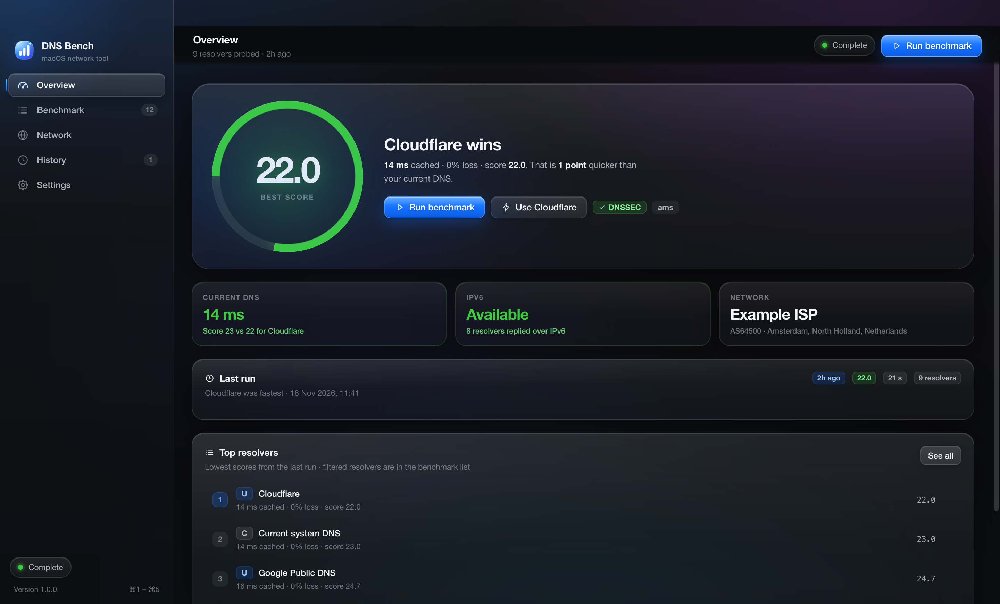
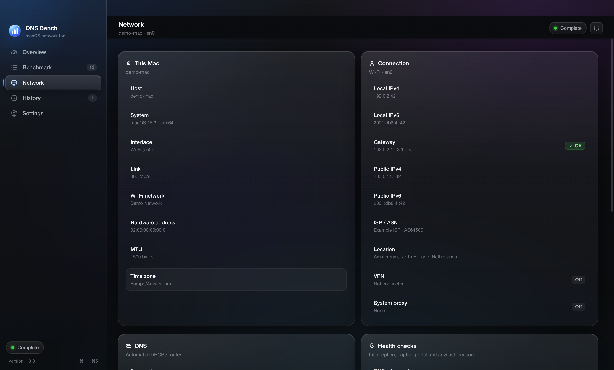
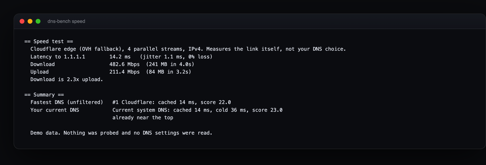

# dns-bench

**Your "best DNS" is someone else's.** This measures ~50 public resolvers from the machine you are actually on — cached vs cold lookups, jitter, loss, DNSSEC, NXDOMAIN hijacking, DoT/443, anycast node, and which resolver gives you the closest CDN edge.

One script. No daemon, no telemetry, no dependencies beyond what ships with your OS. macOS, Linux, Windows, plus a Mac app. **v3.2.0**, MIT.



*every screenshot in this README is generated by demo mode — no real host, IP, ISP or history*

## the part that surprised me

Rank by cached latency and Google wins. Rank by what you actually feel — first lookups, not a warm cache — and it loses badly. From one run on my network (52 resolvers, 3 samples, Wi-Fi):

```
resolver             cached    cold
Google                 44      162
Cloudflare             53      141
Quad9 (unfiltered)     49      141
Neustar UltraDNS       59       58   <- won
my router               9       95
```

Neustar won *despite* the worst cached latency of that group, because it had the best worst case. My router beat every public resolver on cached lookups by 4-5x and fell apart the moment anything was cold.

That inversion is the whole point. One number would have picked Google. It is also why `dns-bench` weights cold lookups double when it scores:

```
(cached + 2*cold) / 3 + 3*loss%
```

## install

### macOS / Linux

```sh
curl -fsSL https://raw.githubusercontent.com/dharmsharmaa/dns-bench/main/dns-bench.zsh -o dns-bench.zsh
chmod +x dns-bench.zsh
./dns-bench.zsh
```

`chmod +x` is what makes the script executable; forget it and you get `permission denied`. It is once per download.

No zsh yet? The script bootstraps itself and offers to install it:

```sh
sh dns-bench.zsh          # works from sh or bash; re-execs under zsh
bash dns-bench.zsh        # same
DNSBENCH_ASSUME_YES=1 sh dns-bench.zsh   # unattended
```

It detects `brew`, `apt`, `dnf`, `yum`, `pacman`, `zypper` or `apk`, shows the exact command, and asks first. Not a terminal? It refuses to install silently and prints the command instead. zsh ships with macOS, so this mainly matters on minimal Linux images.

Prefer a command instead of `./dns-bench.zsh`:

```sh
./dns-bench.zsh install          # ~/.local/bin/dns-bench
./dns-bench.zsh install --system # /usr/local/bin/dns-bench (sudo)
dns-bench
```

Requirements: `dig`, `curl`, `perl`, `awk`, `nc`, `ping` — all ship with macOS. On Linux: `dnsutils`/`bind-utils` plus `iproute2`. `sudo` is only used for `networksetup`/`nmcli`/`resolv.conf` changes, flushing the cache, and `--system` installs, and it asks before doing anything.

### Windows

```powershell
curl.exe -fsSL https://raw.githubusercontent.com/dharmsharmaa/dns-bench/main/dns-bench.ps1 -o dns-bench.ps1
powershell -ExecutionPolicy Bypass -File .\dns-bench.ps1
```

Windows blocks downloaded scripts by default. Either run it with `-ExecutionPolicy Bypass` as above, or unblock once and run it normally:

```powershell
Unblock-File .\dns-bench.ps1
.\dns-bench.ps1
```

Changing DNS needs an **elevated PowerShell** (Run as Administrator); benchmarking works as a normal user. Works with Windows PowerShell 5.1 and PowerShell 7+.

To use it as a command:

```powershell
New-Item -ItemType Directory -Force "$HOME\bin" | Out-Null
Move-Item .\dns-bench.ps1 "$HOME\bin\dns-bench.ps1"
Add-Content $PROFILE 'function dns-bench { & "$HOME\bin\dns-bench.ps1" @args }'
```

Open a new PowerShell window and `dns-bench` works like it does on macOS/Linux.

> The raw URLs above point at the canonical repo. If you fork this, replace the URL in the two commands and in the `UPDATE_URL` / `$script:UpdateUrl` constants at the top of each script.

## quick start

```sh
./dns-bench.zsh              # full run, then asks what to apply
./dns-bench.zsh -q -N        # 30 seconds, report only, changes nothing
./dns-bench.zsh best -y      # quick benchmark, apply the winner
./dns-bench.zsh test example.com   # why is this one domain broken
./dns-bench.zsh speed        # is the link slow, or is it DNS?
./dns-bench.zsh flush        # clear the OS cache after switching
```

```powershell
.\dns-bench.ps1
.\dns-bench.ps1 -Quick -ReportOnly
.\dns-bench.ps1 best -Yes
.\dns-bench.ps1 speed
```

`-N` / `-ReportOnly` is the safe one: it prints everything and touches nothing. I'd suggest running that first, on any machine, before letting it change your DNS.

## what it measures

**Per resolver** — median cached latency, median cold latency (random names under com/net/org so nothing is warm), jitter, packet loss, DNSSEC validation, NXDOMAIN hijacking, TCP/53, DoT:853, 443 reachability, a rough ad-block check, and which anycast PoP answered.

**Your network** — local IPs, gateway and latency, public IPv4/IPv6, ISP/ASN, location, VPN/proxy, DNS currently in use, nearest Cloudflare PoP, first traceroute hops. It also checks whether your router or ISP is intercepting port 53, and whether you are behind a captive portal.

**Distance, not opinion** — TCP connect time to AWS regions on every continent. Physical distance, independent of which DNS you pick.

**Popular services** — resolves ~30 sites (google, youtube, meta, netflix, hotstar, flipkart, github, npm, openai, anthropic, zoom, steam, cdns) through the top resolvers, then times a TCP connect to the IP each one handed back. Fastest lookup is not always the closest edge.

**Speed** — latency, jitter, download and upload with parallel streams, so you can tell whether a slow site is DNS or just the link.

**Troubleshooting** — `test DOMAIN` compares resolvers, prints records, checks authoritative name servers and SOA serials, DNSSEC, TCP/HTTPS reachability, and ends with a plain-English verdict.

## commands

| command | zsh | PowerShell | what it does |
|---|---|---|---|
| `run` (default) | `./dns-bench.zsh` | `.\dns-bench.ps1` | full benchmark + tables, then asks what to apply |
| `info` | `dns-bench info` | `.\dns-bench.ps1 info` | network info only |
| `test DOMAIN` | `dns-bench test example.com` | `.\dns-bench.ps1 test example.com` | troubleshoot a domain |
| `best` | `dns-bench best` | `.\dns-bench.ps1 best` | quick benchmark, apply the fastest unfiltered resolver |
| `adblock [off]` | `dns-bench adblock` | `.\dns-bench.ps1 adblock` | apply the fastest ad-blocking resolver (`off` = automatic DNS) |
| `set NAME\|#` | `dns-bench set cloudflare` | `.\dns-bench.ps1 set cloudflare` | apply a resolver without benchmarking |
| `reset` | `dns-bench reset` | `.\dns-bench.ps1 reset` | back to automatic DNS (DHCP/router) |
| `flush` | `dns-bench flush` | `.\dns-bench.ps1 flush` | clear the OS DNS cache |
| `status` | `dns-bench status` | `.\dns-bench.ps1 status` | what DNS you use now |
| `list` | `dns-bench list` | `.\dns-bench.ps1 list` | print the resolver list |
| `speed` | `dns-bench speed` | `.\dns-bench.ps1 speed` | network speed test: latency, jitter, download, upload |
| `demo` | `dns-bench demo` | `.\dns-bench.ps1 demo` | print a full sample run with fake data (no network, no changes) |
| `auto` | `dns-bench auto` | — | unattended: quick benchmark, switch only if clearly better |
| `cron WHEN\|off` | `dns-bench cron daily` | — (use Task Scheduler) | schedule `auto` |
| `install` / `uninstall` | `dns-bench install` | see above | add/remove the `dns-bench` command |
| `update` | `dns-bench update` | `.\dns-bench.ps1 update` | pull the latest script from GitHub |
| `version`, `help` | `dns-bench version` | `.\dns-bench.ps1 version` | version / help |

## options

zsh flags and their PowerShell equivalents:

| zsh | PowerShell | meaning |
|---|---|---|
| `-d DOMAIN` | `-Domain` | domain for the cached test (default `google.com`) |
| `-n N` | `-Samples N` | samples per resolver, 1-20 (default 5) |
| `-t K` | `-TopK K` | resolvers in the service test, 1-12 (default 5) |
| `-x LIST` | `-ExtraServices` | extra hostnames for the service test |
| `-o FILE` | `-Csv FILE` | save results as CSV to FILE |
| `--no-csv` | `-NoCsv` | don't auto-save a CSV |
| `--no-progress` | `-NoProgress` | plain output, no progress bar |
| `-r LIST` | — | (test) extra resolver IPs |
| `-T LIST` | — | (test) record types to show |
| `-s` | `-SkipServices` | skip the popular-service test |
| `-c` | `-SkipGeo` | skip the continent test |
| `-q` | `-Quick` | quick mode (skip services + continents, 3 samples) |
| `-P` | `-Privacy` | no external IP/geo lookups |
| `-N` | `-ReportOnly` | never change DNS |
| `-y` | `-Yes` | don't ask, apply the best resolver |
| `--profile P` | — | `auto`/`cron`: `best` or `adblock` |
| `--min-gain PCT` | — | `auto`: only switch if this much better (default 20) |
| `--at HH:MM` | — | `cron`: time of day |
| `--system` | — | install into `/usr/local/bin` |
| `--duration SECS` | `-Duration SECS` | (speed) seconds per phase, 2-60 (default 10, `-q`/`-Quick` uses 4) |
| `--no-upload` | `-NoUpload` | (speed) skip the upload test |

`DNSBENCH_JOBS=N` (zsh) changes how many probes run at once (default 24). `DNSBENCH_CSV_DIR=/path` changes where CSVs go.

## why i made this

Most "best DNS" lists are written from a datacenter somewhere else. The resolver that wins on a blog post is often not the one that is fastest from your couch, on your ISP, on your Wi-Fi. I wanted one command that answers the boring but useful questions:

- which resolver is actually fastest from *this* network right now?
- is my router or ISP hijacking DNS or rewriting NXDOMAIN?
- does the resolver validate DNSSEC, block ads, answer over TCP/DoT, and which anycast node do I land on?
- which resolver hands me the closest CDN edge for the sites I actually use?
- why does one domain fail while everything else works?

So it measures instead of guessing, shows you the numbers, and then optionally applies the winner — with a backup of your old settings.

## screenshots

Everything below was captured in demo mode, so no real network, resolver timing, or history appears.

| | |
|---|---|
|  |  |
| *overview — score gauge, current DNS, top 5* | *benchmark — every resolver, sortable, with Apply* |
|  |  |
| *network — identity, DNS source, health checks* | *settings — samples, domain, concurrency, results folder* |


*cli — the benchmark table, ranked with cached/cold latency and feature columns.*



*cli — `speed`, independent of which DNS you use.*


*cli — the full `demo` run: network block, benchmark, features, regions, speed, summary.*

## the mac app

Source lives in [`source/`](./source); build products, `node_modules` and the packaged app in `releases/` stay on your machine and are git-ignored, so only `source/app/` and `source/scripts/` are versioned.

```sh
source/scripts/build.sh    # builds releases/DNS Bench.app
source/scripts/run.sh      # builds if needed, then opens it
source/scripts/dev.sh      # live development (Electron)
```

Same probe engine as the CLI:

- **Overview** — glass gauge with the best score, current DNS vs the fastest switchable resolver, IPv6/ISP cards, last run, ranked top-5.
- **Benchmark** — filters (unfiltered / filtered / ads / current), search, sortable table with latency bars, live progress, auto-selected inspector with every probe result and a one-click Apply.
- **Network** — identity, connection, DNS source, health checks.
- **History** — last 20 runs kept on this Mac; load any back into the table.
- **Settings** — samples, domain, concurrency, auto-export, IPv6, results folder, About.
- **Menu bar + tray** — run, apply best, reset DNS, open results. CSV lands in `~/Library/Application Support/DNS Bench/results`.

A workspace agent lives at [`.github/agents/mac-developer.agent.md`](./.github/agents/mac-developer.agent.md), encoding the design bar (Apple HIG, Liquid Glass, typography, motion, accessibility, packaging) for anyone touching the app.

Requirements: macOS 12+, Node 22 for building. The app needs the same `dig`/`curl`/`ping`/`networksetup` as the CLI; changing DNS triggers the normal macOS admin prompt.

> There was no Xcode on the build machine, so no SwiftUI SDK to compile against. The app is an Electron shell with a native macOS window (hidden inset titlebar, real vibrancy, traffic lights, forced dark appearance, ad-hoc signed bundle) and a hand-built glass interface. Design contract: [`source/app/DESIGN.md`](./source/app/DESIGN.md) — portable to SwiftUI when Xcode is available.

### the app build

`releases/DNS Bench.app` is **not** in git. It is a 253 MB local build artifact produced by `source/scripts/build.sh` (Electron runtime plus app payload and generated icons). Cloning the repo does not give you a binary; you build one.

**is it safe?**

- It is **ad-hoc signed** (`codesign --sign -`). No Developer ID, so it is **not notarized**; on another Mac Gatekeeper shows the "unidentified developer" prompt. Right-click → **Open**, or clear quarantine: `xattr -dr com.apple.quarantine "releases/DNS Bench.app"`.
- The bundle contains app code and the Electron runtime only — **no history, no results, no settings, no personal data**. Those live outside it in `~/Library/Application Support/DNS Bench`.
- It has the same access as the CLI you would otherwise run: `dig`, `curl`, `ping`, and `networksetup` when you click Apply.

**distributing it:** don't commit the bundle. Zip it and attach the zip to a GitHub Release, or tell people to run `source/scripts/build.sh`. A 253 MB binary would bloat the repo permanently and is not reproducible; the build script is.

## clear the DNS cache

Switching resolvers is only half the job; the OS may keep handing out answers from the old one.

```sh
dns-bench flush          # macOS / Linux
.\dns-bench.ps1 flush    # Windows
```

| platform | command |
|---|---|
| macOS | `dscacheutil -flushcache; killall -HUP mDNSResponder` |
| Linux (systemd-resolved) | `resolvectl flush-caches`, or `systemd-resolve --flush-caches` on older installs |
| Linux (nscd) | `nscd -i hosts` |
| Windows | `Clear-DnsClientCache` then `ipconfig /flushdns` |

Use it after `set`, `best`, `adblock` or `reset`, or whenever a site resolves to a stale address while `dig @1.1.1.1` looks correct. macOS and systemd paths need elevation. If there is no `resolvectl`, `systemd-resolve` or `nscd`, the cache is upstream in your router and the command says so.

## speed test

`dns-bench speed` measures the link itself — DNS choice does not affect it.

- **Latency and jitter** to 1.1.1.1 (falls back to 8.8.8.8) via ICMP.
- **Download and upload** against Cloudflare's speed endpoint, using parallel streams so fast links are not bottlenecked by a single connection.
- Live meter while downloading, then a compact summary. `-o FILE` / `-Csv FILE` writes a small `metric,value,unit` CSV.

```sh
./dns-bench.zsh speed                  # 10 s per phase
./dns-bench.zsh speed --duration 5     # shorter
./dns-bench.zsh speed --no-upload      # don't burn upstream bandwidth
./dns-bench.zsh speed -q -o speed.csv  # 4 s phases + CSV
```

```powershell
.\dns-bench.ps1 speed
.\dns-bench.ps1 speed -Duration 5 -NoUpload
```

Cloudflare rate-limits bursty use (HTTP 429). When that happens the CLI retries nothing blindly, switches to the OVH mirror for download, and says so in the output — uploads need Cloudflare, so that phase reports the rate limit and is skipped. Numbers from different mirrors are not directly comparable; the output always names the mirror it used.

## progress bar and csv

Both versions show a progress bar. zsh updates it in place and scrolls cleanly into the results; PowerShell uses the native `Write-Progress` bar. Use `--no-progress` / `-NoProgress` for plain log output.

Every `run`/`best`/`adblock` writes a timestamped CSV **next to the script**:

```
dns-bench-<hostname>-YYYYmmdd-HHMMSS.csv
```

- `-o FILE` / `-Csv FILE` writes to an explicit path instead.
- `--no-csv` / `-NoCsv` disables the automatic file.
- `DNSBENCH_CSV_DIR=/path` changes the directory (falls back to `$HOME` if the script directory is not writable, e.g. `/usr/local/bin`).

Columns: `sortkey, idx, name, kind, region, cached_ms, jitter_ms, loss_pct, cold_ms, score, v4_ping, v6_dns, v6_ping, dnssec, nxdomain, tcp53, dot853, port443, blocks_ads, pop`.

## demo mode

You should not have to trust a stranger's screenshot, and you should not have to expose your network to take one. Both CLIs and the app have a demo mode that produces a full-looking run from hardcoded data.

```sh
./dns-bench.zsh demo          # macOS / Linux
.\dns-bench.ps1 demo          # Windows
source/scripts/run.sh --demo  # macOS app, or launch the bundle with --demo
```

What is fake:

- addresses come from the reserved documentation ranges — TEST-NET-1 `192.0.2.x`, TEST-NET-2 `198.51.100.x`, TEST-NET-3 `203.0.113.x`, and `2001:db8::/32` for IPv6
- lookups use `example.com`
- the ISP is literally `Example ISP (AS64500)`, location is Amsterdam, hostname is `demo-mac`

Everything else — layout, columns, ranking, prompts — is the real code path. Demo mode makes **no network requests** and **never changes DNS settings**, so it is safe on a locked-down machine. Timings are illustrative, not measurements.

The app also has screenshot flags, which is how the images above were made:

```sh
"releases/DNS Bench.app/Contents/MacOS/DNS Bench" --demo \
  --screenshot=docs/screenshots/app-overview.png \
  --screenshot-screen=overview \
  --screenshot-delay=1800
```

- `--screenshot=<png>` writes a PNG and exits; without it the app runs normally.
- `--screenshot-screen=overview|benchmark|network|history|settings` picks the screen.
- `--screenshot-delay=<ms>` waits before capturing (default 1800).
- `--screenshot-run` starts a demo benchmark first, so the table is populated.
- `--screenshot-scroll=<px>` scrolls the content area before capturing.

## updating

```sh
./dns-bench.zsh update --check   # is there a newer version?
./dns-bench.zsh update           # download, validate, back up, replace
./dns-bench.zsh update --force   # reinstall even if the version matches
```

```powershell
.\dns-bench.ps1 update -Check
.\dns-bench.ps1 update
.\dns-bench.ps1 update -Force
```

The source URL lives at the top of each script (`UPDATE_URL` in zsh, `$script:UpdateUrl` in PowerShell). Override it per run without editing:

```sh
DNSBENCH_UPDATE_URL=https://example.com/dns-bench.zsh ./dns-bench.zsh update
```

The zsh updater runs `zsh -n` on the download and refuses a file that is not a script or has a syntax error. The old version is kept as `dns-bench.zsh.<version>.bak`.

## picking a resolver

At the end of a run it asks what to do:

- enter / `best` : fastest unfiltered resolver
- `svc` : best for the popular services test
- a number : that row from the tables
- `reset` : back to automatic DNS
- `q` : quit

Filtered resolvers (malware/family/adblock) are marked `F` or `A` and never get picked automatically. Your current DNS and your router show up as `C` rows so you can compare. Your old settings are appended to `~/.dns-bench-previous.txt` before anything changes.

## notes

- takes 1-2 min with everything on. `-q` / `-Quick` is much faster.
- run it a couple of times; Wi-Fi noise moves numbers around.
- some resolver IPs were written from memory. If one shows `Timeout` every time, check the address.
- the ad-block column is a guess based on a few domains, don't trust it much.
- external lookups (cloudflare trace, ipwho.is) see your public IP. Use `-P` / `-Privacy` if you don't want that.
- `demo` mode never touches DNS, and never makes a request: no lookups, no speed test, no geo lookup.
- the zsh script can bootstrap itself (`sh dns-bench.zsh`) and installs zsh on request when it is missing.
- macOS and Linux are fully supported by the zsh script. The PowerShell version targets Windows and uses `Resolve-DnsName`, `Get-NetAdapter`, and `Set-DnsClientServerAddress`; a few macOS-only checks (traceroute hop detail, port-53 interception) are not in the Windows version.

## credits

`dns-bench` stands on other people's infrastructure and tools: the resolver operators whose public endpoints get benchmarked, the measurement endpoints used for throughput, geo and DNSSEC checks, and the system utilities each platform ships. [`CREDITS.md`](./CREDITS.md) lists them by group, with links.

Short version: thanks to Cloudflare, Google, Quad9, AdGuard, Control D, NextDNS and the rest of the public resolver community; to `dig`, `curl`, `ping`, and the OS networking tools; to Electron and Node for making a Mac app possible without Xcode; and to GRC DNS Benchmark, DNSPerf and the public resolver test pages for showing what a useful DNS measurement looks like. Trademarks belong to their owners; being listed is not an endorsement.

## license and usage

MIT. See [LICENSE](./LICENSE).

You are free to use, copy, modify, merge, publish, distribute, sublicense, and sell copies of this software, including commercially. Keep the copyright notice, and don't blame me if your DNS breaks. Attribution is appreciated but the license does not require it beyond keeping the notice.

If this saved you some time, the only thing I ask is that you point people at [dharmsharma.com](https://dharmsharma.com).
